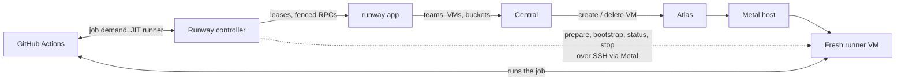
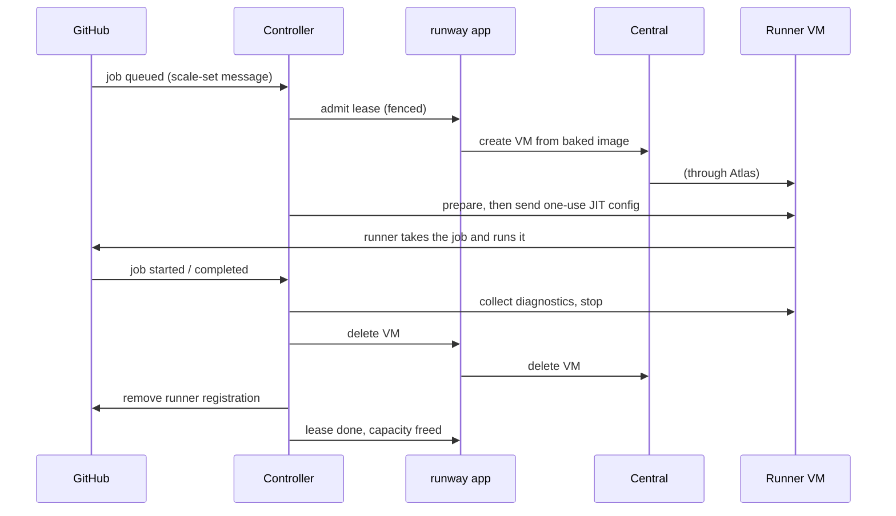
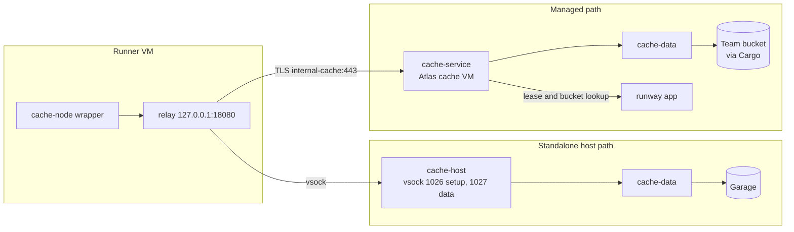

# Architecture

Runway gives GitHub Actions jobs a fresh Frappe Cloud VM. Each runner runs one
job, then its VM is deleted. GitHub still owns workflows, logs, checks and
artifacts. Runway only supplies the machines.

## The big picture

| Part | What it does |
| --- | --- |
| **Runway controller** (this repo, `--action controller`) | Watches GitHub for queued jobs, asks the `runway` app for capacity, boots the runner, and cleans up afterwards |
| **`runway` app** (a separate Frappe app) | Stores Runner Pools and Runner Leases, checks who may act, counts capacity, and deletes expired VMs |
| **Central** | Teams, permissions and billing; creates and deletes VMs and buckets for the `runway` app |
| **Atlas and Metal** | Place VMs, manage images and disks, and run Firecracker |
| **Guest agent** (`guest/guest_agent.py`) | Runs inside the VM: prepares it, starts the one-job runner, reports status, collects diagnostics |
| **Cargo** | Provides the storage bucket behind the managed cache |
| **GitHub Actions** | Schedules and runs workflows; Runway does not change the runner |

## One job, start to finish

The `runway` app keeps counting the slot until **both** the VM and the GitHub runner are
confirmed gone.

## Rules that keep it safe

- **Write intent first.** The controller records a lease, job and JIT attempt
  in the `runway` app before calling anything remote. After a crash it picks up from
  that record.
- **Never retry blindly.** A VM create that timed out is found again by its
  tags, not created twice. If it can't be found, the lease stays blocked for
  an operator.
- **Deleting isn't done until it's gone.** An accepted DELETE only starts
  deletion. Runway checks the VM is actually absent.
- **One owner at a time.** The controller holds a fenced ownership claim in
  the `runway` app and renews it every 15 seconds. If renewal fails, it stops polling
  and leaves the GitHub session alone so the new owner can take over.
- **The app cleans up without the controller.** Its scheduler expires VMs past their
  deadline even when the controller is down. The controller still has to come
  back to remove GitHub registrations.
- **No secrets in guests.** The GitHub App key, Central credentials and cache
  storage keys stay on the host. A guest only gets its one-use JIT config.
  Docker runs inside the VM, never through a host socket.

## Regional Actions cache

Jobs in Bengaluru are slow to reach GitHub's cache in the US. Runway can serve
`actions/cache`, `actions/setup-node` and `astral-sh/setup-uv` from a nearby
store instead. A small wrapper (`cmd/cache-node`) replaces the runner's Node
binary. It reroutes only allowlisted, hash-pinned cache actions, and only for
same-repository branch pushes and manual runs. Anything else, or any setup
failure, falls back to GitHub's cache.

There are two ways to run it:

| | Standalone | Managed |
| --- | --- | --- |
| Runners | Launched directly on the blr-1 host | Created by the controller through the `runway` app |
| Who checks the job | `cache-host`, using job records the host observes itself | `cache-service`, using the `runway` app's lease records |
| Storage | Garage on the host | A per-Team bucket that Central creates through Cargo for the `runway` app |
| Status | Qualified live (98% hit rate) | Built and tested; first live cache hit waits for the production trial |

In both, the host decides which job a guest is running. A guest's own claims
never unlock the cache. Grants are signed, scoped to one repository, ref and
job, and expire with the job. Archives are checked by size and SHA256 before
they're served. See the [cache spec](../specs/runway-regional-cache.md) for the
details.

## Where the code lives

| Path | Contents |
| --- | --- |
| `controller*.go` | Controller: GitHub sessions, lease engine, `runway` app client, guest transport |
| `cache*.go`, `cache/` | Cache services, grants, storage and wire protocol |
| `cmd/cache-node` | The guest-side Node wrapper and its allowlist |
| `guest/` | Guest agent and runner scripts |
| `scripts/` | Guest transport, image building and VM tools |
| `deploy/` | systemd units and setup for the standalone guest, regional cache and Garage |
| `integrations/` | Central contract tests, cache relay and cache client tests |

## Limits today

- One runner at a time per pool, and one Metal host for guest transport.
- Trusted internal workflows only. Network isolation for untrusted or fork-PR
  jobs isn't proven yet.
- No customer dashboard, billing or usage ledger.
- The `runway` app isn't published yet.

Monitoring is described in [monitoring](monitoring.md), and day-to-day
operation in [pilot operations](pilot.md).

## Upstream contracts

- [Atlas architecture at the inspected revision](https://github.com/frappe/atlas/blob/339735de16471e90232cf8b1ff840696ee830ad9/docs/start/architecture.md)
- [Central coordination with Atlas and Pilot](https://github.com/frappe/central/blob/6676d3178943d332c288fc55c04e6f44a8d01732/spec/ATLAS_COORDINATION.md)
- [GitHub scale-set listener contract](https://github.com/actions/scaleset/blob/e6daac702355cdb5b880b4fbdcf6d85dcd9e48e5/listener/listener.go)

These describe the inspected revisions. Atlas and Central are pre-production,
so check the contracts again when updating either.
